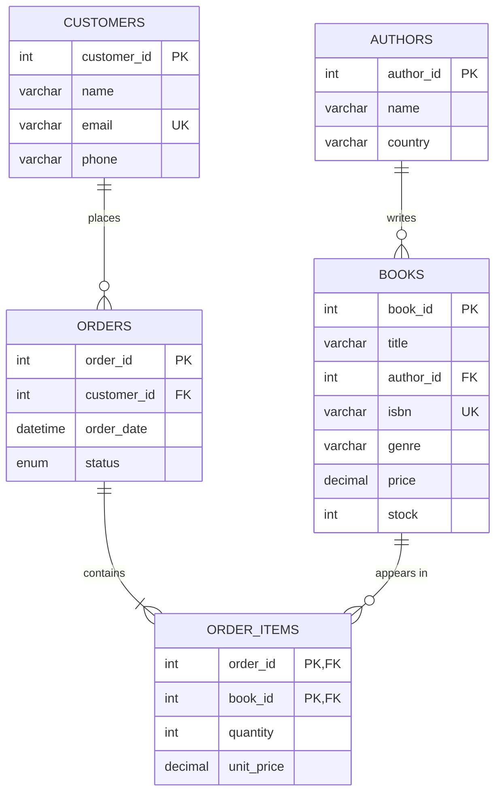

# 📚 Bookstore Management System

A relational-database-backed web app for managing a bookstore's **books, authors, customers and orders**.
Built for the DBMS course project.

| Layer     | Technology |
|-----------|------------|
| Database  | MySQL 8 (designed/run in MySQL Workbench) |
| Backend   | Python 3 + Flask (REST API), `mysql-connector-python` |
| Frontend  | HTML + CSS + vanilla JavaScript (calls the API with `fetch`) |

---

## 1. Database Design

### ER Diagram



### Relationships
- **Authors → Books**: one-to-many. Deleting an author who still has books is blocked (`ON DELETE RESTRICT`).
- **Customers → Orders**: one-to-many. Deleting a customer deletes their orders (`ON DELETE CASCADE`).
- **Orders ↔ Books**: many-to-many, resolved by the junction table **`order_items`** (composite PK `order_id, book_id`).

### Constraints & integrity
- `UNIQUE` on `books.isbn` and `customers.email`
- `CHECK (price >= 0)`, `CHECK (stock >= 0)`, `CHECK (quantity > 0)`
- `ENUM` for order status
- `order_items.unit_price` stores the price **at time of purchase**, so later price changes don't alter old orders
- Placing an order runs in a **transaction** with `SELECT … FOR UPDATE` row locks; if any book lacks stock the whole order rolls back
- View **`book_sales`** aggregates copies sold and revenue per book (JOIN + GROUP BY)

The schema is in 3NF: every non-key attribute depends only on its table's key (author details live in `authors`, not repeated in `books`; order line data lives in `order_items`).

---

## 2. Setup / Re-creation Instructions (Windows)

### Prerequisites
- Python 3.10+ — https://www.python.org/downloads/ (tick **"Add Python to PATH"**)
- MySQL Server 8 + MySQL Workbench — https://dev.mysql.com/downloads/installer/
- Git — https://git-scm.com/

### Steps

**1. Clone the repo**
```powershell
git clone https://github.com/<your-username>/bookstore-dbms.git
cd bookstore-dbms
```

**2. Create the database**
- Open **MySQL Workbench** → connect to your local server
- *File → Open SQL Script…* → choose `schema.sql`
- Click the ⚡ (Execute) button. This creates the `bookstore` database, all tables, the view, and sample data.

**3. Set your MySQL password**
```powershell
copy config.example.py config.py
```
Open `config.py` and replace `your_mysql_password_here` with your MySQL root password.
(`config.py` is git-ignored so your password never gets pushed.)

**4. Create a virtual environment & install dependencies**
```powershell
python -m venv venv
.\venv\Scripts\Activate.ps1
pip install -r requirements.txt
```
> If PowerShell blocks the activate script, run once:
> `Set-ExecutionPolicy -Scope CurrentUser RemoteSigned`

**5. Run the app**
```powershell
python app.py
```
Open **http://127.0.0.1:5000** in your browser.

---

## 3. REST API

| Method | Endpoint | Description |
|--------|----------|-------------|
| GET    | `/api/books` | List all books (joined with author name) |
| GET    | `/api/books/<id>` | Get one book |
| POST   | `/api/books` | Create a book |
| PUT    | `/api/books/<id>` | Update a book |
| DELETE | `/api/books/<id>` | Delete a book |
| GET/POST/PUT/DELETE | `/api/authors[/<id>]` | Same CRUD for authors |
| GET/POST/PUT/DELETE | `/api/customers[/<id>]` | Same CRUD for customers |
| GET    | `/api/orders` | List orders with customer, item count, total |
| GET    | `/api/orders/<id>/items` | Line items of an order |
| POST   | `/api/orders` | Place order (transaction, decrements stock) |
| PUT    | `/api/orders/<id>` | Update order status |
| DELETE | `/api/orders/<id>` | Delete order (restores stock) |
| GET    | `/api/reports/sales` | Sales per book from `book_sales` view |

Example — place an order:
```json
POST /api/orders
{ "customer_id": 1, "items": [ { "book_id": 2, "quantity": 3 } ] }
```

---

## 4. Project Structure
```
bookstore-dbms/
├── app.py            # Flask backend + REST API
├── config.example.py # DB connection template (copy to config.py)
├── schema.sql        # Database schema + sample data
├── requirements.txt
├── static/
│   └── index.html    # Frontend (single page, vanilla JS)
└── screenshots/      # UI screenshots for the report
```
